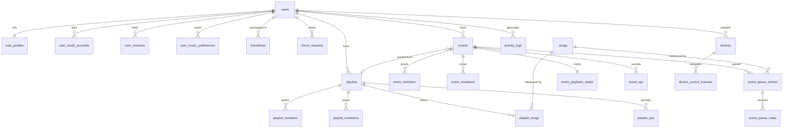
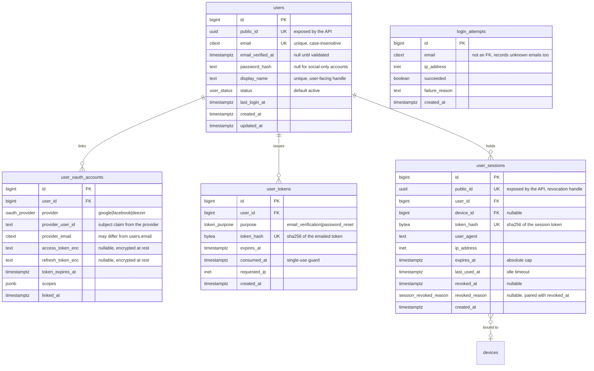
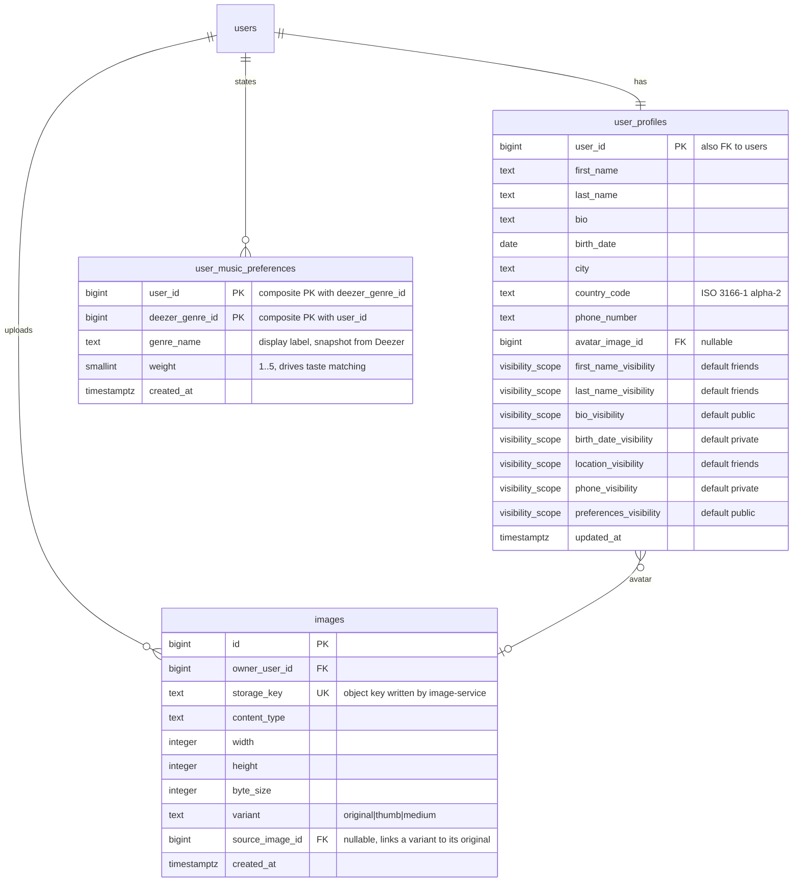
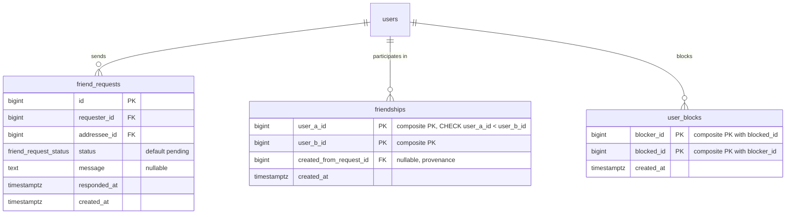
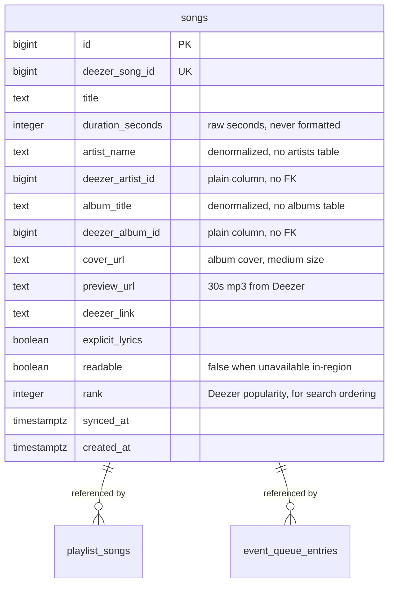
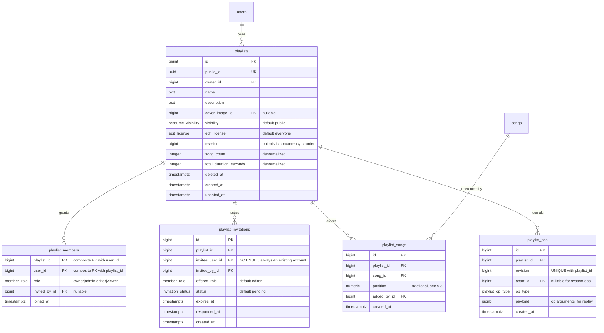
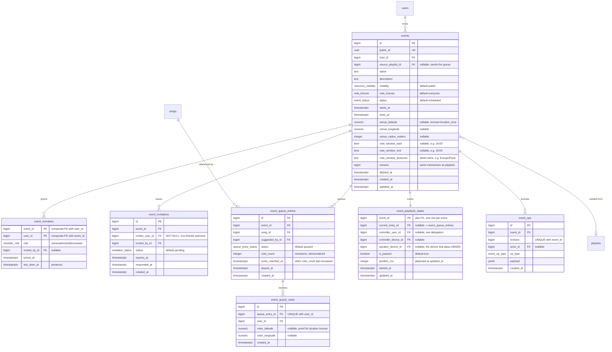
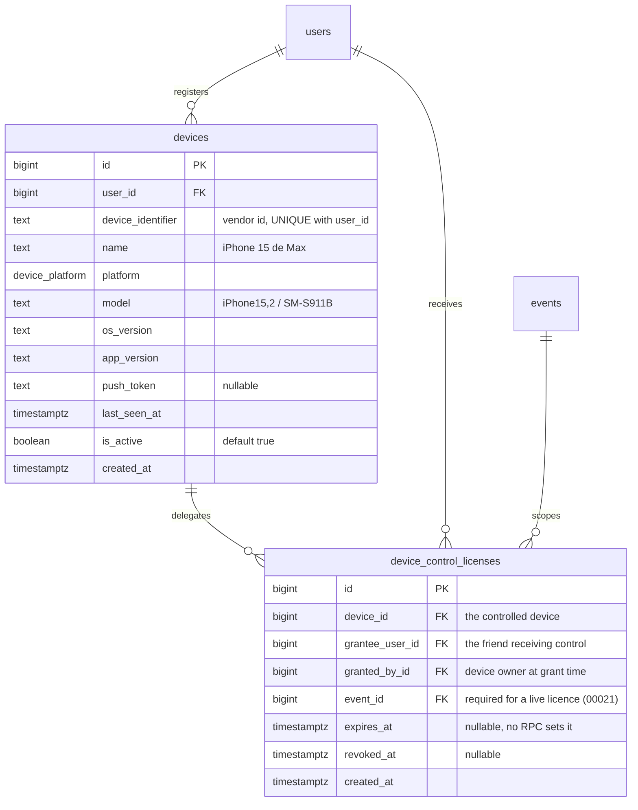
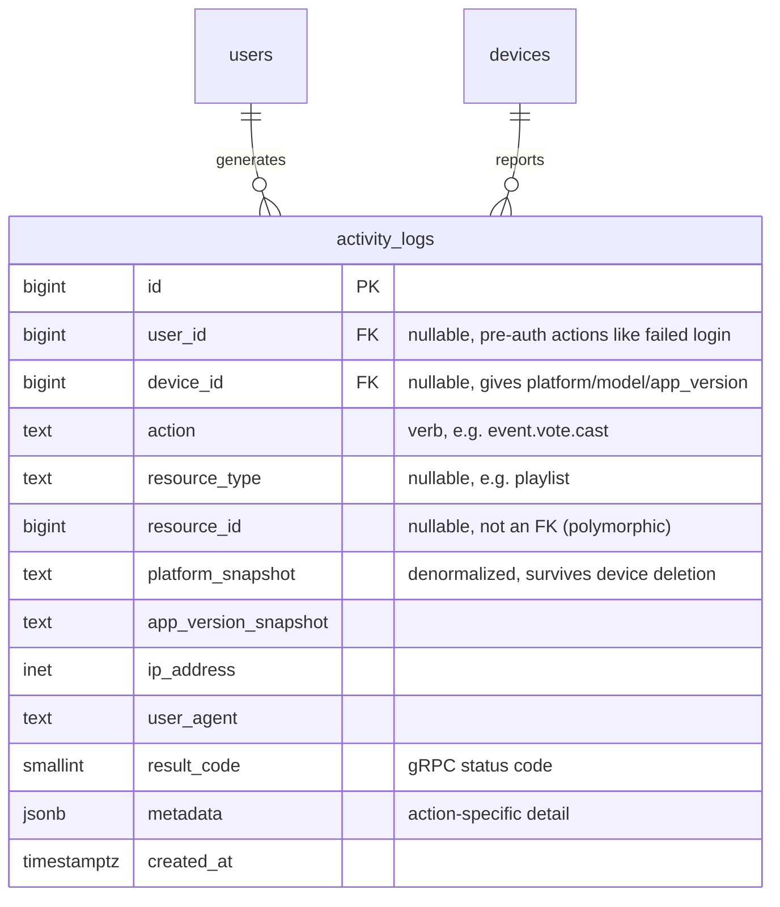

# Music Room — Data Model

Target: PostgreSQL 16, migrations with `goose` (`backend/db/schema`), typed queries with `sqlc` (`backend/db/query`).

**27 tables in 8 domains.**

## 1. Scope and decisions

Driven by the mandatory part of the subject (`en.subject.pdf`, chapter V):

| Decision | Choice | Consequence |
| --- | --- | --- |
| "Sessions" — two meanings | **Listening sessions = Track Vote rooms** (`events`); **auth sessions = `user_sessions`** (§5) | The rooms are named `events` to match the subject's wording ("your event is public"), which leaves "session" free for the auth sense. The auth table is still prefixed `user_` so neither reading of the bare word can be mistaken for the other in a query. |
| Authentication | **Opaque server-side session tokens, not JWTs** | `user_sessions` is the session store and is read on every authenticated request. No access/refresh split, no signature verification, no token-rotation chain — see §5. |
| Session store | **Postgres only, for now** | Redis is running in the stack but holds nothing session-related. It is a plausible future home for the hot lookup; §5 records what would have to move and what the cost is today. |
| Services covered | **All three** | Track Vote (§10), Playlist Editor (§9), Control Delegation (§11). |
| Deezer catalog | **One flat `songs` cache table** | No `artists` / `albums` / `genres` / `song_likes` tables. Rationale in §8.1 — it is the load-bearing simplification of this model. |
| Membership / roles / invites | **Postgres is the source of truth** | Real tables (`*_members`, `*_invitations`, `visibility`, `*_license`). OpenFGA tuples are *derived* from these rows, so the DB stays self-consistent and the app is shippable before FGA exists. See §14. |
| Accounts | **Mandatory — no anonymous use** | Every actor is a `users` row. Invitations always target an existing account; there is no invite-by-email path and no shareable invite token (§9.1). |
| Votes | **Upvote-only and final** | Makes the score monotonic, which is what makes the required tiebreaker exact (§10.2). |

Explicitly **out of scope**: subscriptions/billing, offline-sync journals, IoT beacons (all bonus), and push notification delivery state.

## 2. Conventions

- **PKs**: `BIGSERIAL`, matching the existing `users` table. Externally addressable entities (`users`, `playlists`, `events`, `user_sessions`, and since `00017_public_ids` also `devices`, `images`, `event_queue_entries`) carry a `public_id UUID NOT NULL DEFAULT gen_random_uuid() UNIQUE`; the API exposes `public_id` only, so sequential IDs are never enumerable by a client. The permission layer depends on this: an OpenFGA object is named `<type>:<id>` and that id must be the value the client already sent, or every `Check` needs a public-to-internal lookup in Postgres first — see §14.
- **Time**: `TIMESTAMPTZ`, always UTC. Every table has `created_at`; every mutable table has `updated_at` maintained by a shared trigger.
- **Deletes**: hard deletes everywhere except `playlists` and `events`, which use `deleted_at` (they are referenced by logs and op history).
- **Enums**: native Postgres `ENUM` types — `sqlc` generates real Go types for them, which is worth the rigidity. Caveat for migrations: `ALTER TYPE ... ADD VALUE` cannot run inside a transaction, so any migration adding an enum value needs `-- +goose NO TRANSACTION`. Values are never removed.
- **Secrets**: only hashes are stored. `password_hash` (Argon2id), and every token column — including `user_sessions.token_hash`, which is the live credential — is a SHA-256 of the value handed to the client, so a DB leak does not yield usable tokens. SHA-256 rather than Argon2id for tokens on purpose: they are 256 bits of CSPRNG output, not guessable secrets, and the session lookup is on the hot path of every request.
- **Ordering**: playlist ordering uses fractional `NUMERIC` positions (§9.3), never a dense integer sequence. Event queue ordering is derived from votes (§10.1).
- **Naming**: `songs`, not `tracks` — the existing proto contract already says `SongDTO` / `GetSong` / `SearchSongs`, and the DB should not introduce a second vocabulary for the same thing.

### Enum types

```sql
CREATE TYPE user_status         AS ENUM ('active', 'suspended', 'deleted');
CREATE TYPE oauth_provider      AS ENUM ('google', 'facebook', 'deezer');
CREATE TYPE token_purpose       AS ENUM ('email_verification', 'password_reset');
CREATE TYPE session_revoked_reason AS ENUM ('logout', 'user_revoked', 'password_change', 'admin', 'suspected_theft');
CREATE TYPE visibility_scope    AS ENUM ('public', 'friends', 'private');   -- profile fields
CREATE TYPE resource_visibility AS ENUM ('public', 'private');              -- playlists, events
CREATE TYPE edit_license        AS ENUM ('everyone', 'invited_only');
CREATE TYPE vote_license        AS ENUM ('everyone', 'invited_only', 'location_time');
CREATE TYPE member_role         AS ENUM ('owner', 'admin', 'editor', 'viewer');
CREATE TYPE invitation_status   AS ENUM ('pending', 'accepted', 'declined', 'revoked', 'expired');
CREATE TYPE friend_request_status AS ENUM ('pending', 'accepted', 'declined', 'cancelled');
CREATE TYPE event_status        AS ENUM ('scheduled', 'live', 'ended');
CREATE TYPE queue_entry_status  AS ENUM ('queued', 'playing', 'played', 'skipped');
CREATE TYPE device_platform     AS ENUM ('ios', 'android', 'web', 'desktop');
CREATE TYPE playlist_op_type    AS ENUM ('create', 'rename', 'add_song', 'remove_song', 'move_song', 'visibility_change', 'license_change', 'member_change', 'ownership_transfer');
CREATE TYPE event_op_type       AS ENUM ('create', 'suggest_song', 'vote', 'play', 'pause', 'skip', 'seek', 'status_change', 'member_change', 'control_change');
```

## 3. Overview



## 4. Domain map

| § | Domain | Tables |
| --- | --- | --- |
| 5 | Identity & auth | `users`, `user_oauth_accounts`, `user_tokens`, `user_sessions`, `login_attempts` |
| 6 | Profile, preferences, media | `user_profiles`, `user_music_preferences`, `images` |
| 7 | Social graph | `friend_requests`, `friendships`, `user_blocks` |
| 8 | Deezer song cache | `songs` |
| 9 | Playlist Editor | `playlists`, `playlist_members`, `playlist_invitations`, `playlist_songs`, `playlist_ops` |
| 10 | Track Vote | `events`, `event_members`, `event_invitations`, `event_queue_entries`, `event_queue_votes`, `event_playback_states`, `event_ops` |
| 11 | Control Delegation | `devices`, `device_control_licenses` |
| 12 | Audit & security | `activity_logs` |

---

## 5. Identity and authentication

Subject V.1: signup by mail/password **or** social (Facebook/Google), ability to link a social account afterwards, mandatory email validation, password reset.

**Authentication is opaque server-side session tokens, not JWTs.** The client is handed 256 bits of
CSPRNG output at login and sends it back on every request; the server hashes it and looks up
`user_sessions`. That one decision removes three mechanisms the earlier draft of this section carried:

| Not here | Why it existed under JWT | Why it is gone |
| --- | --- | --- |
| Access/refresh token split | A signed token cannot be revoked, so it has to be short-lived, so something longer-lived has to mint replacements | Revocation is `UPDATE user_sessions SET revoked_at = NOW()`, effective on the very next request. Nothing needs to be short-lived to be safe. |
| Rotation chain (`rotated_from_id`) + reuse detection | The only way to notice a stolen refresh token, since the access token itself was unverifiable server-side | Nothing to rotate: there is one credential and it is checked against the store every time. Theft is handled by revocation, not detection (§13). |
| Signature verification / key management | Every request had to verify an HMAC or RSA signature and the signing key had to be rotated | One indexed lookup on `token_hash`. No keys to manage, no algorithm-confusion class of bug. |

The cost of the trade is explicit and accepted: **every authenticated request now performs a database
read.** That read is a unique-index hit on a narrow table, which is about the cheapest query Postgres
can serve, and it buys instant revocation and a truthful "these are your active sessions" screen.
`GetSessionByHash` joins `users` in the same round trip so the account-status check is free.



**Notes**

- `password_hash` is nullable: a Google-first signup has no password. The invariant is "at least one usable credential", enforced in the service layer, not by a constraint — a user can legitimately unlink their last provider *after* setting a password.
- `users.email` is `NOT NULL UNIQUE`. Facebook may not return an email; in that case the signup flow must prompt for one before the account row is created. This keeps email as the single account identity and makes provider linking unambiguous.
- Unique indexes: `(provider, provider_user_id)` — one Music Room account per provider identity; `(user_id, provider)` — one Google account per user.
- **Two independent lifetimes, both enforced in Go, not by a constraint.** `expires_at` is the absolute cap — a session dies at that instant however active it was. `last_used_at` carries the idle timeout: `authn.Authenticate` compares it against `APP_SESSION_IDLE_DAYS` (default 7) and rejects a session that has been quiet longer than that, before the absolute cap is anywhere near. Neither can be a `CHECK`, because both are questions about `NOW()` and `NOW()` is not immutable, so it cannot appear in a check constraint or an index predicate. Same reason `user_tokens` enforces its single-use window in the service layer.
- **`last_used_at` is the one write on the hot path**, and the reason it is worth naming: updating it on literally every request turns a read-only auth check into a read *and* a write. `TouchSession` is therefore called conditionally — skipped unless `last_used_at` is already older than a minute (`authn.touchInterval`), which costs a minute of precision on a seven-day window and saves a write per request. A failed touch is logged and ignored: the session is valid, only the sliding is lost, and refusing would turn a write outage into a read outage. Concurrent requests on the same session race to write the same column; last-write-wins is exactly right here, so no lock and no read-modify-write.
- **`revoked_at` + `revoked_reason` move together**, asserted by `CHECK ((revoked_at IS NULL) = (revoked_reason IS NULL))`. Revoked rows are kept rather than deleted: "why am I logged out" is answerable, and V.6 wants the trail. The `session_revoked_reason` values distinguish a normal logout from a mass revocation after a password change from a session the user killed from their device list from a suspected theft.
- **`public_id` is the revocation handle**, for an active-sessions screen that does not exist yet (no RPC lists or revokes another session today). Such a screen has to name *other* sessions, and the client does not hold their tokens — it only has its own. Per §2, a BIGSERIAL must never be exposed, so sessions get a UUID like `users` / `playlists` / `events` do; a revocation by it must scope the update by `user_id` as well, so a leaked UUID alone revokes nothing.
- **Session theft is answered by revocation, not detection** (V.6's "session theft" hazard). A stolen session token is usable until the row is revoked — there is no in-band signal that distinguishes the thief from the owner. What the schema provides instead: a password change mass-revokes every session (the reset flow), and each session keeps its device, IP and last-use time, so a future screen could list them and kill one. `user_agent` / `ip_address` are stored to make that screen legible and to let a future anomaly check flag `suspected_theft`; they are not consulted during authentication, because tying a session to an IP breaks every mobile client that changes network.
- `login_attempts` backs brute-force throttling (V.6). Rows older than ~30 days are pruned by a cron. The live counter is a Redis candidate; until then it is counted off this table, which is what the `(email, created_at DESC)` index is for.
- **WebSocket auth** is simpler than it was under the JWT plan, and in one respect harder. Simpler: the socket presents the session token at handshake and there is no in-band re-authentication dance, because nothing expires in minutes. Harder: a session can be revoked *while a socket is open*, and revoking a row does not close a live connection. So the server has to either re-validate periodically on long-lived streams or push revocations to the goroutine holding the socket. Single-instance that is an in-process registry; multi-instance it wants Redis pub/sub, which is the second thing on the "if Redis, then" list below.
- **Redis holds nothing session-related today.** Sessions live in Postgres and are read from Postgres. If that changes, these are the candidates, in the order they would actually start to hurt: (1) cache `token_hash → session` to take the per-request read off Postgres, with revocation doing a write-through delete — note the cache must be authoritative or revocation stops being instant, which is the whole point of the design; (2) pub/sub to close live WebSockets on revocation across instances; (3) the `login_attempts` rate counter; (4) buffering `activity_logs` writes (§12). None of these change this schema — that is deliberate, and it is why the decision can wait.

## 6. Profile, preferences and media

Subject V.1: the profile must expose **public**, **friends-only** and **private** information, plus music preferences.



**Notes**

- Per-field `*_visibility` columns rather than a generic `(user_id, field_name, visibility)` table. Adding a profile field requires a migration for the field itself anyway, so the generic table buys no flexibility while costing type safety and a join on every profile read. Resolving a profile view becomes one row fetch plus one friendship lookup.
- The three visibility tiers map directly onto `visibility_scope`; a profile read for viewer *V* of owner *O* keeps field *f* when `f_visibility = 'public'`, or `= 'friends'` and `friendships` contains the `(V, O)` pair, or *V = O*.
- **No `genres` lookup table.** Deezer's genre list is ~25 static entries served by `GET /genre`; the client sends the genre id and its label, and the user's choice is stored here with the label snapshotted. (No backend genre proxy exists yet — `MusicProviderService` has only `GetSong` and `SearchSongs` — and nothing is cached in Redis, which the backend no longer connects to.) A local `genres` table would need a seed script and a sync job to hold data we can fetch in one call. The cost is a duplicated display string per preference row — bounded by 25 × user count and never joined on.
- `images` exists because the Rust `image-service` produces derived variants that need to be addressable and permission-checked (called out in `notes20261108.md`). `source_image_id` ties `thumb`/`medium` back to the original so cascade-deleting an avatar cleans up its variants.
- `weight` is what makes "collaborate with people with the same musical tastes" (V.2.3) a query rather than a guess.
- **No `user_favorite_artists`.** The subject requires only "their music preferences" (V.1) with no further specification; genre weights satisfy it. Removed.

## 7. Social graph



**Notes**

- Two tables on purpose. `friend_requests` is **directional and auditable** (who asked, when, declined or not). `friendships` is **undirected and canonical**: exactly one row per pair, enforced by `CHECK (user_a_id < user_b_id)`. "Are A and B friends?" is then a single index lookup on the PK with the pair pre-sorted by the caller — no `OR`, no duplicate rows to reconcile.
- Guard against crossed pending requests (A→B and B→A both open) with a normalised partial unique index:

  ```sql
  CREATE UNIQUE INDEX friend_requests_one_open_per_pair
      ON friend_requests (LEAST(requester_id, addressee_id), GREATEST(requester_id, addressee_id))
      WHERE status = 'pending';
  ```

- `friendships` needs a secondary index on `(user_b_id)` — the PK only covers lookups leading with `user_a_id`, and "list my friends" must match either side.
- `user_blocks` is directional and is checked before inserting any invitation row. Since invitations deliberately target **non-friends** (§9.1), this table is the only thing standing between a private event's invite list and a harassment vector. It is not optional.

## 8. Deezer song cache

One table. Read-through cache: on a miss, fetch from Deezer, upsert on `deezer_song_id`, return the local row. `synced_at` is meant to drive revalidation (a TTL of ~7 days is generous; catalog metadata is near-static), but no TTL sweep is built yet: a row is refreshed only when a Deezer response upserts it again. Nothing fronts this table — there is no Redis cache — and Postgres is what playlists and queues reference by FK.



### 8.1 Why one flat table and not artists / albums / genres

What the two endpoints we actually call return:

| Field | `GET /track/{id}` | `GET /search?q=` |
| --- | --- | --- |
| `artist { id, name, picture_* }` | nested inline | nested inline |
| `album { id, title, cover_* }` | nested inline | nested inline |
| `isrc`, `bpm`, `release_date`, `contributors` | present | **absent** |

Two facts follow.

**Normalizing is free but worthless.** Because artist and album arrive nested in every response, splitting them into `artists` / `albums` requires no extra HTTP call — but it also buys nothing, because the entire query surface is "songs of playlist N" and "queue of event N". Each candidate reason to normalize fails on this project:

- *Update anomalies* — the classic reason. Does not apply: this is a read-only mirror, refreshed wholesale by `deezer_song_id`. We never edit an artist name, so it cannot drift out of sync with itself.
- *Storage dedup* — an artist name is tens of bytes against a table that will hold thousands of rows, not billions. Irrelevant.
- *Browse-by-artist / by-album / by-genre screens* — not in the subject, not in the proto contract. If they ever land, `deezer_artist_id` is already on the row, so "more from this artist" is a proxied Deezer call with **no migration**, and normalizing later is a mechanical backfill.

So the four tables collapse to one, and `playlist_songs` / `event_queue_entries` reads stop needing a three-way join to render a row.

**The field list has a rule.** `songs` holds only fields present in *both* payloads. A row populated from a search result is therefore complete and never needs a follow-up `/track/{id}` fetch to fill holes — which is exactly the anomaly that makes a cache hard to reason about. `isrc` and `release_date` are dropped under this rule, not by accident.

`duration_seconds` stays an integer. `deezer_client.go` currently formats to `"MM:SS"` before the DTO leaves the backend — presentation belongs to the client, and the DB must hold the sortable value.

**No `song_likes`.** The `SongDTO.IsLiked` field is per-viewer state unrelated to building playlists, and nothing in the subject asks for it. Dropped; the DTO field stays hardcoded `false` until a feature actually needs it.

## 9. Music Playlist Editor

Subject V.2.3: real-time multi-user editing, visibility public/private (default public), edit license everyone/invited-only (default everyone), and explicit handling of concurrent edits.



### 9.1 Access resolution and invitations

Read access: `visibility = 'public'`, **or** a `playlist_members` row for the viewer. Write access: `edit_license = 'everyone'` and the playlist is readable, **or** a `playlist_members` row with `role IN ('owner','admin','editor')`. The owner always has both — `playlist_members` gets an `owner` row at creation so no query needs to special-case `playlists.owner_id`.

Invitations target an **existing account**, always: `invitee_user_id BIGINT NOT NULL REFERENCES users(id)`. Nobody uses the app without an account, so there is no `invitee_email` column, no `CHECK` reconciling two nullable invitee columns, and no `token_hash` for shareable links — the invitation row *is* the mechanism, delivered in-app. This is a real reduction in surface: a token-link flow would need expiry, single-use enforcement, and a signup-on-accept path, none of which can exist here.

An invitee is explicitly **not required to be a friend** — inviting non-friends to an event or playlist is the point. So there is no friendship constraint on invitations; the only precondition is the absence of a `user_blocks` row in either direction.

Partial unique index on `(playlist_id, invitee_user_id) WHERE status = 'pending'` stops invite spam.

### 9.2 Real-time fan-out

`playlist_ops` is an append-only journal keyed by `(playlist_id, revision)` — that pair is `UNIQUE`. Every mutation, in one transaction:

```sql
UPDATE playlists SET revision = revision + 1, updated_at = NOW()
 WHERE id = $1 AND deleted_at IS NULL
 RETURNING revision;              -- row lock serialises concurrent writers
-- ... apply the change to playlist_songs ...
INSERT INTO playlist_ops (playlist_id, revision, actor_id, op_type, payload)
VALUES ($1, $revision, $actor, $op, $payload);
```

The `UPDATE ... RETURNING` takes a row lock on the playlist, which makes revisions gapless and totally ordered. Subscribers on the gRPC stream receive ops in revision order; a client that reconnects sends its last-seen revision and replays the tail instead of refetching the playlist. Old ops are prunable after a retention window.

### 9.3 Concurrent reordering

`position` is `NUMERIC` and set to the **midpoint** of its neighbours, so inserting or moving a song writes exactly one row and never renumbers the rest — two users moving different songs simultaneously do not conflict at all. Two users moving the *same* song are serialised by the revision lock; the loser's client sees the op and rebases. Midpoints are computed as `(a + b) * 0.5`, never `(a + b) / 2`: `NUMERIC` division rounds to a fixed scale (20 digits here), so about 65 moves into the same slot would produce two equal positions, while multiplication is exact (one more digit per halving). No gap ever runs out, so there is no rebalancing job. A move names its place relatively ("after song Y", `MoveSongInPlaylist`), so it stays meaningful after other people's edits and is refused only when the song or its anchor was removed.

Index `(playlist_id, position)`. Duplicate songs in a playlist are **allowed** (no unique on `(playlist_id, song_id)`) — it is legitimate in a DJ set; add the unique index if product decides otherwise.

## 10. Music Track Vote — events / listening sessions

Subject V.2.1: anyone can suggest or vote for the next track; a track with many votes moves up and plays earlier; visibility public/private (default public, private = invited only can find it *and* vote); license = everyone can vote by default, or invited-only, or restricted to people in a given place during a given time window; concurrent votes must be handled correctly.



### 10.1 Queue ordering and the tiebreaker

The queue needs no `position` column — it *is* the vote ranking. The required rule is "highest votes first; on a tie, whichever song **reached** that vote total first". Two columns express it exactly:

```sql
SELECT * FROM event_queue_entries
 WHERE event_id = $1 AND status = 'queued'
 ORDER BY vote_count DESC, score_reached_at ASC;
```

Covering index: `(event_id, status, vote_count DESC, score_reached_at)`.

- `score_reached_at` defaults to `NOW()` at insert, which makes it exactly equal to the row's own `created_at` — so an entry with zero votes sorts by suggestion time, the natural extension of the same rule. On increment it is taken from the inserted vote's `clock_timestamp()`, **not** `NOW()`; see §10.2, this distinction is load-bearing and was caught by a concurrency test, not by reading the code.
- **This is exact, not an approximation**, and only because votes are monotonic (§10.2). `score_reached_at` always holds the timestamp of the vote that brought the entry to its *current* count. Two entries tied at 7 votes therefore order by who hit 7 first, regardless of who was suggested first or who was leading earlier.
- No new table. It is derivable for reconciliation — `score_reached_at` must equal `MAX(created_at)` over that entry's `event_queue_votes` (or `created_at` when it has none), which is a one-query integrity check. It is denormalized rather than computed because the queue is re-read by every connected client on every change, and a correlated `MAX()` per entry on the hot read path is not worth saving one column.

A song may be re-suggested after it has played, but not queued twice at once:

```sql
CREATE UNIQUE INDEX event_queue_entries_one_active_per_song
    ON event_queue_entries (event_id, song_id)
    WHERE status IN ('queued', 'playing');
```

### 10.2 Concurrent voting

This is the competition problem the subject calls out. Votes are **upvotes only and final**: there is no `value` column and no unvote. The subject only ever says users "suggest or vote for" the next track — it never describes a downvote or a retraction — and making votes final is what keeps `vote_count` monotonically increasing, which is the precondition for the tiebreaker above being exact. A user tapping twice is a no-op, not a toggle.

Four mechanisms, all in one statement:

1. `UNIQUE (queue_entry_id, user_id)` makes double-voting **structurally impossible** — no read-then-write race can defeat it.
2. `ON CONFLICT DO NOTHING` makes the RPC idempotent under client retries.
3. The count and its timestamp are updated atomically, and only when a vote row was actually inserted.
4. The timestamp comes from `clock_timestamp()` and is wrapped in `GREATEST`, which is what keeps it monotonic.

```sql
WITH inserted AS (
    INSERT INTO event_queue_votes (queue_entry_id, user_id, voter_latitude, voter_longitude)
    VALUES ($1, $2, $3, $4)
    ON CONFLICT (queue_entry_id, user_id) DO NOTHING
    RETURNING created_at          -- DEFAULT clock_timestamp(), not NOW()
)
UPDATE event_queue_entries e
   SET vote_count       = e.vote_count + 1,
       score_reached_at = GREATEST(e.score_reached_at, (SELECT created_at FROM inserted))
 WHERE e.id = $1
   AND e.status = 'queued'
   AND EXISTS (SELECT 1 FROM inserted)
RETURNING e.vote_count, e.score_reached_at;
```

The `UPDATE` is a read-modify-write on a single row under Postgres row locks, so N simultaneous votes on the same song serialise and all land — no lost updates, no `SERIALIZABLE` retry loop. Two votes on *different* songs that would tie them cannot get the same `score_reached_at` in practice; if they somehow do, `id ASC` is the final deterministic tiebreak.

**Why `clock_timestamp()` and not `NOW()`.** `NOW()` is the *transaction* timestamp. Concurrent voters acquire the entry's row lock in an order unrelated to when their transactions began, so a voter that started earlier can win the lock later and stamp `score_reached_at` **backwards** — which breaks both the ordering and the reconciliation invariant in §10.1. This is not theoretical: an 80-transaction race against the schema left `score_reached_at` earlier than `MAX(vote.created_at)` on the first attempt. `clock_timestamp()` is read per statement while the lock is held, so readings follow lock order, and `GREATEST` makes the column monotonic regardless. Re-run with the fix: 140 concurrent votes across two entries, counters exact, invariant exact on every row.

### 10.3 License enforcement

| `vote_license` | Rule |
| --- | --- |
| `everyone` | Any user who can see the event (public, or an `event_members` row) may vote. |
| `invited_only` | Requires an `event_members` row. |
| `location_time` | Requires being inside the venue circle **and** inside the daily vote window. |

For `location_time`, the client sends its coordinates with the vote; the backend checks

- distance from `(venue_latitude, venue_longitude)` ≤ `venue_radius_meters`, and
- `(NOW() AT TIME ZONE vote_window_timezone)::time` between `vote_window_start` and `vote_window_end`.

`vote_window_timezone` is stored explicitly because a wall-clock window like "4–6 PM" is meaningless without the venue's zone. Coordinates are persisted on the vote row as the audit trail for a decision that can be contested. Distance can start as the `earthdistance` extension (`ll_to_earth`, adequate at party scale); switching `venue_*` to a PostGIS `geography(Point,4326)` column with a GiST index is a drop-in upgrade if event discovery by proximity ever needs to scale.

Constraint: `CHECK (vote_license <> 'location_time' OR (venue_latitude IS NOT NULL AND venue_longitude IS NOT NULL AND venue_radius_meters IS NOT NULL AND vote_window_start IS NOT NULL AND vote_window_end IS NOT NULL AND vote_window_timezone IS NOT NULL))` — the license and the data it needs cannot disagree.

### 10.4 Playback state

`event_playback_states` is a 1:1 side table rather than columns on `events`: it is written on every play/pause/seek (multiple times per song) while `events` is nearly static, so keeping it separate avoids churning the row that every discovery query reads. `position_ms` plus `updated_at` lets a joining client compute the current playhead without the server pushing ticks.

## 11. Music Control Delegation

Subject V.2.2: a license per **device** attached to the account, and the user can hand music control to different friends.



**Notes**

- The license hangs off `devices`, not off `users` — that is the subject's requirement ("specific for each device attached to the user's account"). Granting a friend control of the living-room tablet says nothing about the phone.
- Unlike invitations, delegation *is* friends-only: the subject says "give the music control to different **friends**". The service layer requires a `friendships` row between `granted_by_id` and `grantee_user_id`.
- A licence is for **one event**: "you can drive my speaker for tonight's party", never "forever". `event_id` is still nullable for the old standing grants, which `00021` revoked; its `CHECK (event_id IS NOT NULL OR revoked_at IS NOT NULL)` means no live one can exist.
- Using a licence is a SQL read, not an OpenFGA `Check` (`ResolveDeviceControlLicense`, from `event/access.go:canControlPlayback`): the device must be the event's speaker (`event_playback_states.speaker_device_id`), and when the host moves the speaker the event's licences move with it. Licences are not in the graph: a tuple is unique per (friend, device), and a friend may hold one licence per event on the same device.
- Friendship is checked only when a licence is written, so the `RemoveFriend` and `BlockUser` transactions revoke every live grant between the two users, both directions (`RevokeDeviceGrantsBetween`).
- One licence, no per-action columns: a delegate drives the whole player of the event (play / pause, next, seek). The per-action booleans were dropped in `00023`.
- Partial unique index `(device_id, grantee_user_id, COALESCE(event_id, 0)) WHERE revoked_at IS NULL` so there is at most one live grant per (device, friend, event).
- Revocation is `revoked_at`, not a delete — who could control what, and when, is exactly the kind of thing you need after an incident.
- `devices.platform` / `model` / `app_version` also satisfy the V.6 logging requirement; `activity_logs` references the device instead of duplicating those three strings on every row.

## 12. Audit and security logging

Subject V.6: *any* action on the mobile application must generate a log on the backend, including platform, device and application version.



**Notes**

- `resource_id` is deliberately **not** a foreign key — it points at whichever table `resource_type` names, and logs must outlive the rows they describe.
- `user_id` stays nullable even though accounts are mandatory: a failed login or an expired-token call has no authenticated user yet, and those are precisely the events worth logging.
- Platform and app version are both referenced (`device_id`) *and* snapshotted, because the log has to stay truthful after a device row is removed. This is one of the few places duplication is right.
- This table grows fastest by an order of magnitude. Declare it `PARTITION BY RANGE (created_at)` monthly from day one — retrofitting partitioning onto a large table is painful. Index `(user_id, created_at DESC)` and `(action, created_at DESC)` per partition.
- Writes must be async (buffered, or via Redis) and must never fail the user's request; an audit write failure is a logged warning, not a 500.

## 13. Concurrency summary

The subject calls out competition problems twice, so here is the whole story in one place:

| Race | Mechanism |
| --- | --- |
| Same user votes twice (double tap, retry) | `UNIQUE (queue_entry_id, user_id)` + `ON CONFLICT DO NOTHING` |
| N users vote the same song at once | Atomic `UPDATE ... SET vote_count = vote_count + 1` under a row lock |
| Two songs tie on votes | `score_reached_at ASC` — exact, because votes are monotonic; `id ASC` as final fallback |
| Lock order disagrees with transaction start order | `score_reached_at` is stamped from `clock_timestamp()` under the row lock and clamped with `GREATEST`, never from `NOW()` (§10.2) |
| Two users move different songs | Fractional `NUMERIC` positions — the writes touch different rows, no conflict |
| Two users move the same song | `playlists.revision` row lock serialises them; the second op is broadcast and the loser rebases |
| Client missed updates while offline | Replay `playlist_ops` / `event_ops` from the last seen revision |
| Two clients add the same song to a queue | Partial unique index on `(event_id, song_id) WHERE status IN ('queued','playing')` |
| Stolen session token replayed | Not detected in-band, by design (§5). Mitigation is revocation, which lands on the attacker's next request because every request reads `user_sessions` |
| Two requests on one session both slide the idle window | Single-column `UPDATE last_used_at = NOW()`, no lock, last-write-wins — the desired semantics, not a race to fix |

No `SERIALIZABLE` isolation anywhere: every hot path is either a unique-constraint insert or a single-row read-modify-write, both of which are correct under `READ COMMITTED` and need no retry loops.

## 14. Mapping to OpenFGA

Postgres holds the truth; FGA tuples are a derived index for fast `Check` / `ListObjects`. The sync rule is one-directional and mechanical:

| Postgres row | FGA tuple |
| --- | --- |
| `playlists(id, owner_id)` | `user:<owner_id> owner playlist:<id>` |
| `playlist_members(playlist_id, user_id, role)` | `user:<user_id> <role> playlist:<playlist_id>` |
| `playlists.visibility = 'public'` | `user:* viewer playlist:<id>` |
| `playlists.edit_license = 'everyone'` | `user:* editor playlist:<id>` |
| `event_members(event_id, user_id, role)` | `user:<user_id> <role> event:<event_id>` |
| `friendships(a, b)` | `user:<a> friend user:<b>` and the reverse |
| `devices(id, user_id)` | `user:<user_id> owner device:<id>` |

`device_control_licenses` produces **no** tuple: a licence is read in SQL (§11). Licence tuples written before `00023` are still in the store, under a relation the model no longer has.

Consequences for the schema, which is why this is decided now rather than later:

- Every table that produces tuples is mutated **only** through a repository method that writes the row and the tuple in the same logical unit. **Implemented** as a transactional outbox: `openfga_tuple_outbox` (migration 15) takes one row per logical change, inserted *inside* the domain transaction, and `backend/internal/authz/outbox` delivers it — an inline attempt right after commit, then a background worker for whatever that could not land. Writing the intent inside the transaction is what makes "a committed change always has a durable tuple intent" an invariant of the database rather than a property of the code path; the earlier plan (commit, then write, then log failures) left a window in which a crash lost the change with no record it was owed. An earlier draft of this bullet named the `*_ops` journals as the retry source, which only ever covered playlists and events.
- The `location_time` vote license maps to FGA only **halfway**. The daily wall-clock window is a CEL `condition` on the tuple (`within_vote_window`, evaluated against the request time and `vote_window_timezone`), so expiry-shaped logic does not get reimplemented per handler. The **venue radius does not** — CEL has no geospatial functions, so the distance test stays a per-handler check in Go after the FGA `Check` passes. Consequence: a `Check` passing means "in the window", never "at the venue".
- The model itself is `authz/model.fga`, with the rules in plain language, per use case, in `docs/annex/permissions.md`. That second file also carries the *residual* Go checks — the things that must be true in addition to a `Check` returning true. Read it before wiring any handler; the model file alone makes authorization look finished.
- The backfill in `notes20261108.md` step 5 is a straight `SELECT` over the seven tables above.

## 15. Migration order

As implemented in `backend/db/schema` — flat files, one per group. Flat is not a style choice: `backend/db/embed.go` embeds `schema/*.sql` and `main.go` calls `goose.Up(db, "schema")`, both of which are non-recursive globs, so files in a subdirectory would be silently ignored — the app would boot, log "up to date", and have no tables.

| # | File | Contents |
| --- | --- | --- |
| 1 | `00001_create_users` | pre-existing bootstrap table |
| 2 | `00002_extensions` | `citext`, `pgcrypto`, `set_updated_at()` trigger function |
| 3 | `00003_enums` | the 16 types from §2 |
| 4 | `00004_alter_users` | rename `name` → `display_name`; add `public_id`, `password_hash`, `status`, `email_verified_at`, `last_login_at`, `updated_at`; `email` → `citext` |
| 5 | `00005_devices` | `devices` |
| 6 | `00006_auth` | `user_oauth_accounts`, `user_tokens`, `user_sessions`, `login_attempts` |
| 7 | `00007_media` | `images` |
| 8 | `00008_profile` | `user_profiles`, `user_music_preferences` |
| 9 | `00009_social` | `friend_requests`, `friendships`, `user_blocks` |
| 10 | `00010_songs` | `songs` |
| 11 | `00011_playlists` | `playlists`, `playlist_members`, `playlist_invitations`, `playlist_songs`, `playlist_ops` |
| 12 | `00012_events` | `events`, `event_members`, `event_invitations`, `event_queue_entries`, `event_queue_votes`, `event_playback_states`, `event_ops` |
| 13 | `00013_delegation` | `device_control_licenses` |
| 14 | `00014_activity_logs` | partitioned parent + 25 monthly partitions + `DEFAULT` |
| 15 | `00015_openfga_outbox` | `openfga_tuple_outbox` — the transactional outbox from §14 |
| 16 | `00016_oauth_intra42` | adds `intra42` to `oauth_provider` (`NO TRANSACTION`) |
| 17 | `00017_public_ids` | `public_id` on `devices`, `images`, `event_queue_entries` |

**Two migrations once shared the number 15**, `00015_oauth_intra42` and `00015_openfga_outbox`, having arrived from different branches. goose panics on a duplicate version (`duplicate version 15 detected`) rather than picking one, so the backend would not boot at all. The oauth one moved to 16 because it was the one that had *never run*: the recorded version 15 is the outbox, and the `oauth_provider` enum was missing `intra42` — a 42 login was failing on a nonexistent enum value. Numbering is a shared namespace across branches; check it before merging.

**The delegation domain is split across two migrations.** An earlier draft of this section put `devices` and `device_control_licenses` together at step 10, after the auth tables — which cannot work: `user_sessions.device_id` references `devices`, so `devices` has to land *before* auth, while `device_control_licenses.event_id` references `events`, so it has to land *after*. Splitting the domain is cheaper than deferred constraints. With that ordering, no forward references remain.

**Two implementation notes that only the real tooling surfaces:**

- goose parses `+goose` annotations out of *comment* lines, so writing one inside explanatory prose fails the file with `invalid annotation`. `00003_enums` describes the `NO TRANSACTION` requirement in words for that reason.
- `sqlc` builds its catalog from every statement in this directory, so 26 literal `CREATE TABLE ... PARTITION OF` statements would become 26 phantom Go structs. `00014` creates its partitions inside a `DO` block, which sqlc's parser treats as opaque, yielding exactly one `ActivityLog` model.

**Deviations from the section above, all deliberate:**

- `cube` + `earthdistance` are not installed. §14 already decided the `location_time` check runs in the Go handler, so no SQL query needs distance math; adding them is a one-line migration when a proximity *query* appears.
- `sqlc.yaml` carries type overrides: `citext` → `string` (sqlc has no built-in mapping and emits `interface{}` without it) and `inet` → `*netip.Addr` (the default `netip.Prefix` is a strange type for a single client IP).
- `user_profiles` and `event_playback_states` got the `created_at` column that §2 requires of every table but the diagrams omitted.

**The session-token change was applied in place, not as a 15th migration.** `00003_enums` and `00006_auth` were edited where they stand: `refresh_tokens` is gone and `user_sessions` takes its place, and `session_revoked_reason` joins the enum list. That is the right call for a schema with no deployed database — a `00015_drop_refresh_tokens` would leave the history telling a story about an auth design that never actually ran. **It does mean goose will not notice.** An existing local database already has version 6 recorded in `goose_db_version`, so `goose.Up` on boot is a no-op and the app will run happily against a `refresh_tokens` table that the code no longer references. Recreate the volume — `make fclean`, or `docker compose down -v` — rather than trying to migrate forward.

## 16. Open questions

1. **Deezer playback.** `songs.preview_url` is a 30-second clip — full playback needs the Deezer SDK with a *premium* user OAuth token. Does the demo run on previews (no extra schema), or on per-user Deezer OAuth (already covered by `user_oauth_accounts.provider = 'deezer'`, but it changes the delegation story since playback then happens on the grantor's authenticated device)?
2. **Event lifecycle.** Does an ended event keep its queue as history, or auto-convert to a playlist? The latter wants an `events.result_playlist_id` column.
3. **Vote finality.** §10.2 forbids unvoting so the tiebreaker stays exact. If the UI must let a user take a vote back, the tiebreak semantics need a decision: either accept an approximation (stamp `score_reached_at` on decrements too, so a song dropping from 5 to 4 sorts behind a song that reached 4 earlier), or replay from `event_queue_votes` to recover the true "first reached N" instant. The former is one line; the latter is a job.
4. **`display_name` uniqueness.** Global unique handle (searchable, squattable) or non-unique display name plus a separate `username`? Currently modelled as unique.
5. **Session lifetimes.** Two numbers are unset and both are service config, not schema: the absolute window written into `expires_at` at login, and the idle window `last_used_at` is compared against. A mobile music app argues for a long absolute window (weeks — nobody wants to re-log-in to vote on a song) and a generous idle one; the V.6 security framing argues the other way. Pick both together, since a long absolute cap with no idle timeout is the weakest combination.
6. **When does Redis take over session lookup?** §5 lists the candidates. The trigger is a measurement, not a preference: if the per-request `GetSessionByHash` shows up in latency profiles under the demo's concurrency, cache it; if it does not, the added invalidation-correctness risk buys nothing. Worth deciding *before* the WebSocket revocation work, because a multi-instance socket registry wants Redis anyway and the two would share it.
